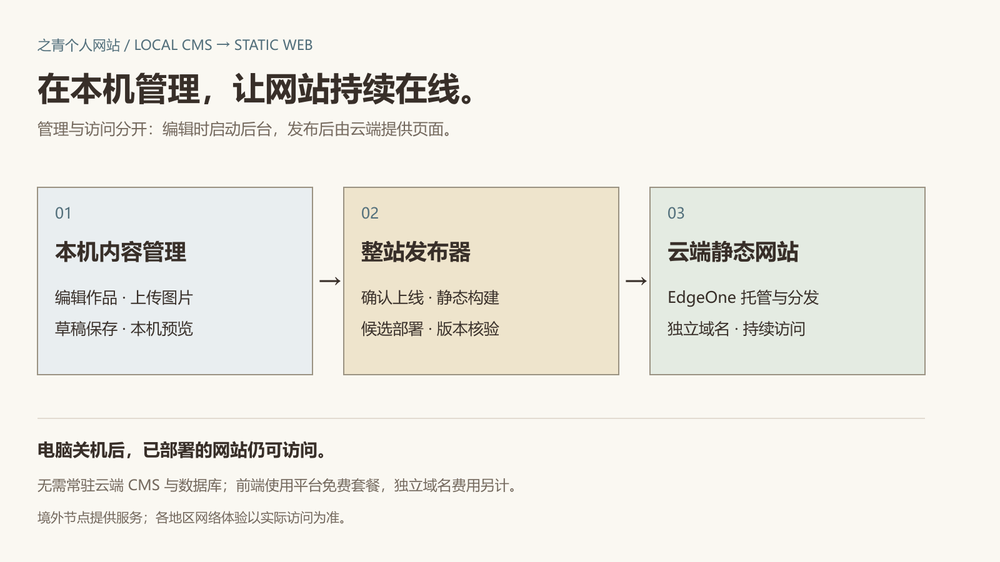
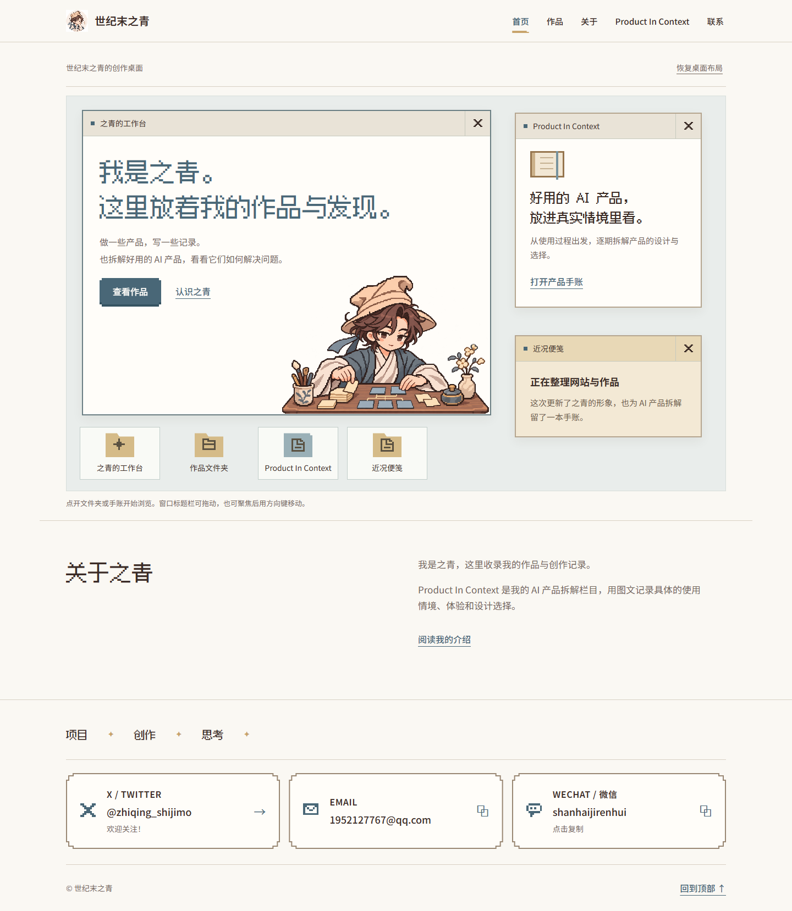
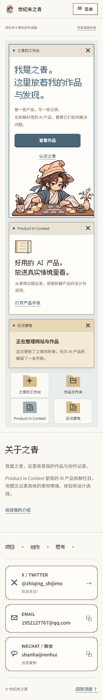

# 之青个人网站

**在自己的电脑上管理内容，把确认上线的版本发布到云端。**

一个由本机 CMS 驱动的个人网站：在电脑上编辑作品、文章和图片，预览后通过整站发布器构建静态页面，部署到 EdgeOne，再通过独立域名对外提供访问。

[访问网站](https://zhiqing-shijimo.site) · [项目案例](https://zhiqing-shijimo.site/works/local-cms-static-publishing) · [架构与运行说明](docs/architecture.md)



## 为什么这样做

我希望个人网站能方便地持续更新，也希望减少服务器费用和日常维护。所以把内容管理与访客访问分开：后台、数据库和私有媒体留在自己的电脑上，云端只托管经过确认的静态页面与资源。

**电脑关机后，已经部署的网站仍可访问。** 只有编辑、构建和上传更新时，才需要运行本机服务。

## 核心实现

- **本机内容管理**：作品、记录和产品拆解的图文编辑，图片上传、草稿保存、预览、历史记录与撤回。
- **按需公开**：上线许可绑定具体内容版本；发布器按许可导出内容和所需媒体，不上传数据库、私有草稿或认证信息。
- **完整发布流程**：固定内容快照 → 静态构建与产物检查 → 候选部署和核验 → 正式部署和域名版本核验。
- **结果可追踪**：进度、发布历史、失败状态和历史版本回退入口；只有正式域名核验通过才报告成功。
- **低成本运行**：线上无需运行常驻 CMS 和数据库，前端利用 EdgeOne 免费套餐托管与边缘分发。

GitHub 用于分享实现源码。日常内容更新由本机发布器直接部署到 EdgeOne，当前不依赖 GitHub Actions 自动发布。

## 网站效果

像素桌面和手账是展示作品、创作记录与产品拆解的载体。桌面窗口支持打开、关闭和拖动，窄屏按阅读顺序排列。下图为 2026 年 11 月正式版本的真实截图。



<details>
<summary>查看手机端截图</summary>



</details>

## 运行前端预览

需要 Node.js >=24.22.1 <25、npm 11。在仓库根目录执行：

```sh
npm ci --ignore-scripts
npm run dev:preview
```

打开 http://127.0.0.1:5173 。公开仓库的本地预览使用明确标识的演示数据，不包含站主本机数据库或私有图文。

前端静态构建：

```sh
npm run build:sites
```

## 本机后台与发布器

技术栈为 TypeScript、React、Next.js、Payload、PostgreSQL 和 Vite。后台当前面向 Windows 回环环境，发布器对当前项目和域名有明确校验，还不是更换变量就能部署的通用 CMS。新机配置步骤、目录与边界见 [架构与运行说明](docs/architecture.md)。

## 免费与访问范围

免费指 EdgeOne 平台套餐内的前端托管，域名费用另计；资源额度、适用规则以 [官方套餐说明](https://pages.edgeone.ai/zh/pricing) 为准。当前项目使用境外节点，通过独立域名和全球边缘分发提供访问；这不代表全球网络体验均已实测，大陆运营商和真实移动设备体验需要分别验证。

## 源码与素材

此仓库提供经过整理的实现源码，不包含运行数据、账号、令牌、备份或历史私有部署材料。像素角色、站名及个人图文是本网站的品牌素材，未授予通用再分发许可；第三方字体遵循其随附许可。
