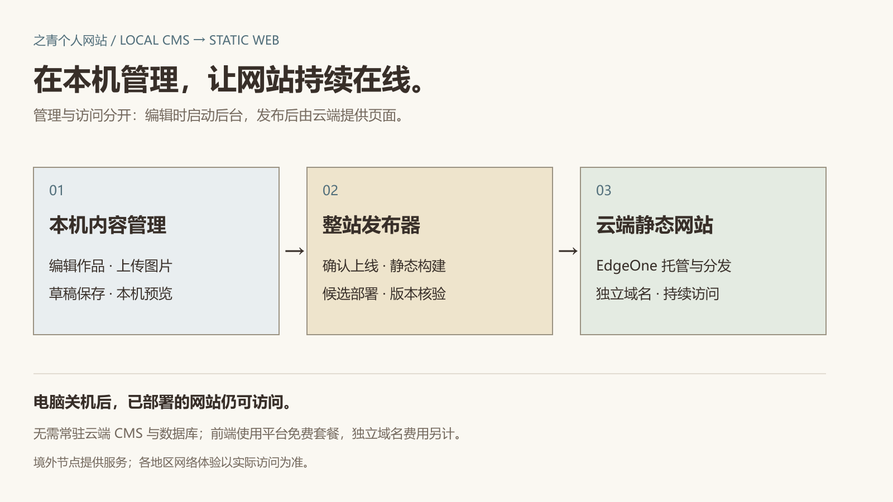

# 架构与运行说明

## 一次内容更新

本机后台编辑与上传 → 保存草稿 → 预览 → 设为待上线 → 整站发布。撤回也需整站发布才同步公网。发布时固定内容快照，构建静态产物，先检查与验证候选，再部署同一组文件到正式环境并核验域名版本。

管理与访问相互独立。电脑关机后，已部署的静态页面继续由平台提供服务；更新时需要本机运行与网络。数据库和媒体由站主自行备份，代码仓库不能替代数据备份。

## 目录

| 目录 | 职责 |
| --- | --- |
| apps/web | Next.js 本机应用、认证和 CMS 接口 |
| apps/preview | Vite 前端预览入口 |
| packages/content | 内容模型、链接规则与编辑字段 |
| packages/ui | 前端共享页面与组件 |
| packages/design | 样式与字体定义 |
| packages/adapters | 前端适配器与演示内容 |
| scripts/site | 内容快照构建、EdgeOne 部署与线上核验 |

## 本机后台初始化

当前维护脚本面向 Windows，需要 Node 24.22.1—24.x、npm 11 以及官方 PostgreSQL 二进制。把 PostgreSQL 的 pgsql/bin 放到 runtime/t3/postgres-bin/pgsql/bin，先安装依赖，再运行 npm run cms:init 初始化本机数据库和 Payload 身份，运行 node scripts/context-migrate.mjs 补充产品拆解栏目迁移。

随后运行 npm run build:web、npm run cms:launch。后台入口是 http://127.0.0.1:3000/admin 。本机身份仅通过 npm run cms:credentials 查看，不应提交或分享。停止用 npm run cms:shutdown，保留数据库和媒体。

现有 scripts/site/common.mjs 和认证配置含当前项目的域名、项目身份、固定回环端口等防误发校验。复用到新项目时，需要先审查这些约束，再以自己的账号配置，不应套用本站的域名或项目身份。部署凭据由官方工具在当前操作系统用户目录维护，不写入源码。

## 维护命令

- npm run site:prepare：导出并构建本机候选，不上传。
- npm run site:check：检查候选产物。
- npm run site:publish：通过已有配置创建正式发布任务。
- npm run site:status：查询发布状态。
- npm run site:rollback -- RELEASE_ID：选择历史发布回退前端，具体可用性由发布历史与内容保留状态决定；不会自动回退数据库。

## 已验证与限制

原项目具有本机生产构建、静态构建、页面/资源版本核验及多视口前端检查记录；本仓库单独核验公开前端构建。真实 iPhone Safari、全球各地区运营商、通用新机端到端迁移不作通过承诺。服务实现供阅读与复用评估，不宣称跨平台开箱即用。
